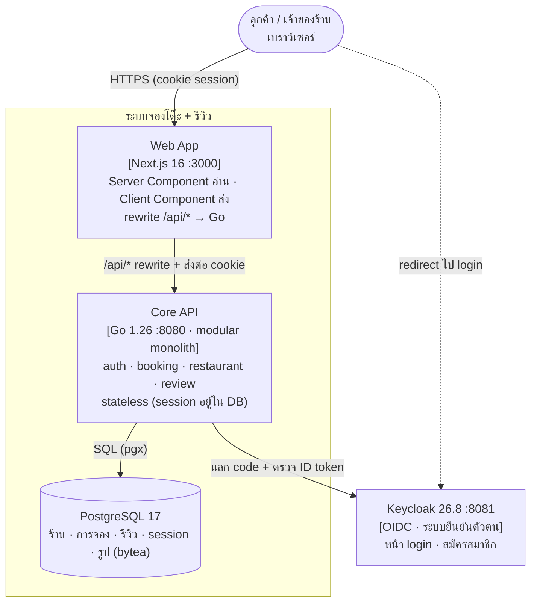
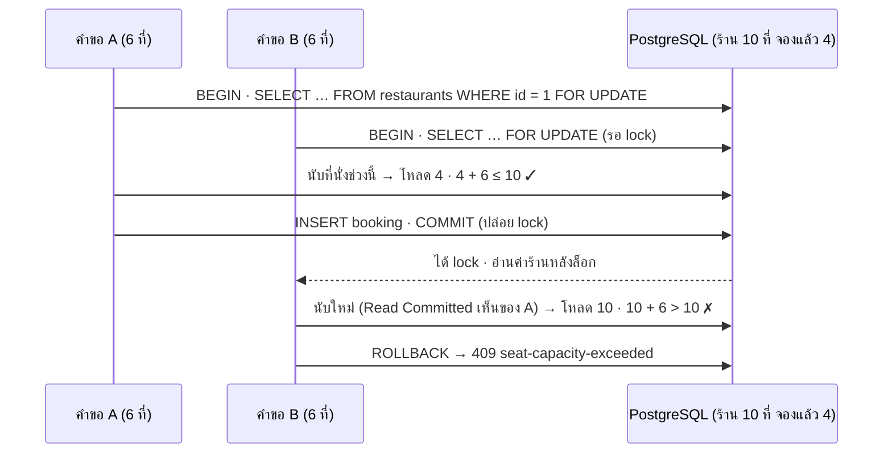
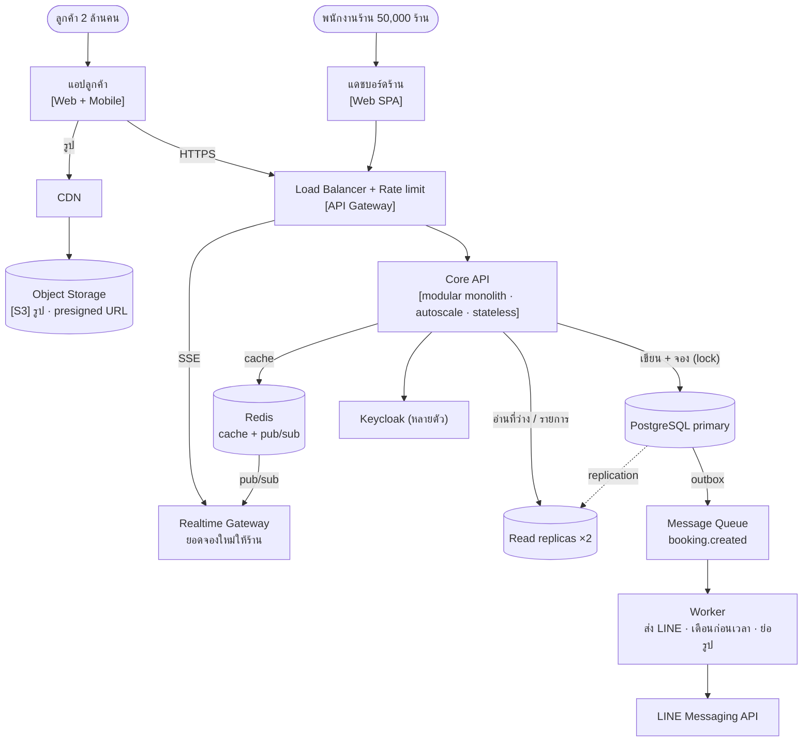

# Architecture — ระบบจองโต๊ะร้านอาหาร + รีวิว

เอกสารนี้อธิบายสถาปัตยกรรมของระบบ **ตอนนี้** (ขนาดงาน Final Exam) และ **ทางโต** ถ้าต้องรองรับทั้งประเทศ
ใช้กรอบ 4 ขั้นจากวิชา Architecture & Scaling: quality attributes → ตัวเลข → C4 → จุดยาก + trade-off
การตัดสินใจหลักบันทึกเป็น ADR ใน [`docs/adr/`](adr/)

---

## 1. โจทย์และขอบเขต

- ผู้ใช้ทุกคนเป็นได้ทั้ง**ลูกค้า** (ค้นร้าน จองโต๊ะ แก้/ยกเลิก รีวิว) และ**เจ้าของร้าน** (สร้างร้าน ตั้งที่นั่ง เวลาเปิด–ปิด นโยบาย ดูการจอง)
- จองแบบ**นับที่นั่งรวมทั้งร้าน** เป็นช่วงเวลา 30 นาที–3 ชั่วโมง ช่องละ 30 นาที
- ขนาดงานจริงตอนนี้: เดโมบนเครื่องเดียว ผู้ใช้หลักสิบ ร้านหลักสิบ → **Stage 0–1**

## 2. Quality attributes (3 อันดับแรก)

| อันดับ | Attribute | ทำไมสำคัญ | ทำอย่างไรในระบบนี้ |
|---|---|---|---|
| 1 | **Consistency** (ที่นั่งไม่เกินจริง) | จองเกินคือความผิดพลาดที่ลูกค้าเห็นทันทีและแก้ย้อนหลังไม่ได้ | ล็อกแถวร้าน + Read Committed, ตรวจ peak แบบ half-open, unique constraint เป็นด่านสุดท้าย ([ADR-0001](adr/0001-postgresql-row-lock.md)) |
| 2 | **Security / Privacy** | ข้อมูลผู้ใช้ (PDPA), สิทธิ์เจ้าของร้าน | Keycloak + session ของแอปเอง token ไม่ถึงเบราว์เซอร์ ([ADR-0002](adr/0002-keycloak-app-session.md)), ตรวจสิทธิ์ที่ API ทุก endpoint, CSRF 3 ชั้น, ไม่เก็บอีเมล |
| 3 | **Maintainability** (อธิบายได้) | ผู้พัฒนาต้องอธิบายโค้ดได้เองในสัมภาษณ์ | modular monolith, SQL เขียนเอง, ไม่มี framework ([ADR-0004](adr/0004-modular-monolith.md)) |

ที่**ยังไม่**จัดอันดับสูง: Availability ระดับหลายเครื่อง และ Performance ระดับแสนผู้ใช้ เพราะยังเป็น Stage 0–1 (ดู §7)

## 3. C4 Level 2 — ระบบตอนนี้



| Container | ความรับผิดชอบ | หมายเหตุ |
|---|---|---|
| Web App | หน้าเว็บทั้งหมด, ส่งคำขอต่อให้ API | ไม่มี `proxy.ts` และไม่ตัดสินกติกาเอง ([ADR-0004](adr/0004-modular-monolith.md)) |
| Core API | กติกาธุรกิจทั้งหมด, สิทธิ์, session, CSRF | 26 endpoint ใต้ `/api` · error เป็น `application/problem+json` |
| PostgreSQL | แหล่งความจริงเดียว | รูปเก็บเป็น `bytea` ([ADR-0003](adr/0003-images-in-postgres.md)) |
| Keycloak | ยืนยันตัวตนอย่างเดียว | Go เป็น confidential client, หลัง login ไม่ใช้ token ของ Keycloak อีก |

### ภายใน Core API (C4 Level 3 แบบย่อ)

```
HTTP → CrossOriginProtection (CSRF) → Session middleware (cookie → userID) → ServeMux
         → handler (แปลง HTTP, อ่าน now)  → service (กติกา, transaction)  → PostgreSQL
                                             └─ booking/capacity.go, rules.go (pure function: MaxLoad, PeakAll, เวลา)
```

| package | หน้าที่ |
|---|---|
| `auth` | OIDC login/callback/logout, session, middleware, `UserID(ctx)`, CSRF |
| `booking` | จอง แก้ ยกเลิก การจองของฉัน ที่ว่าง + อัลกอริทึมที่นั่งและกติกาเวลา (pure) |
| `restaurant` | สร้าง/แก้/ลบร้าน รูป หมวด ตั้งค่า พักรับจอง การจองรายวัน |
| `review` | รีวิว และรายการร้านเรียงด้วย Bayesian average |
| `db`, `httpx`, `config` | transaction + `LockRestaurant`, problem+json + JSON เข้มงวด, อ่าน `.env` |

## 4. จุดยากที่สุด: จองช่วงพีค (เส้นทางที่ต้องถูกเสมอ)

คนหลายคนจองร้านเดียวกันช่วงเดียวกันพร้อมกัน → ห้ามรวมเกิน `capacity` ไม่ว่าเวลาไหน



- **ลำดับต้องเป็น ล็อก → อ่าน → ตัดสิน → เขียน** ถ้านับก่อนล็อก ทั้งสองคำขอจะตัดสินจากตัวเลขเก่าและจองเกิน
- **ล็อกแถวร้าน ไม่ใช่ทั้งตาราง:** ร้านต่างกันทำงานขนานกันได้ ร้านเดียวกันต่อคิวกัน
- **lock อยู่ใน DB ไม่ใช่ในโปรแกรม:** ถ้ารัน Core API หลายตัวหลัง load balancer ยังถูกต้องเหมือนเดิม
- **พิสูจน์ด้วย test:** `TestConcurrentK1` (20 คนแย่ง 6 ที่สุดท้าย ต้องสำเร็จ 1 คน) และ K2–K8 รันแบบ `-race -count=100`
  mutation test ยืนยันว่าถ้าเอา `FOR UPDATE` ออก หรือใช้ Repeatable Read จะจองเกินจริง (ร้าน 10 ที่รับได้ถึง 52 ที่)

ทางเลือกที่พิจารณาแล้วไม่ใช้อยู่ใน [ADR-0001](adr/0001-postgresql-row-lock.md)

## 5. Data model (ตารางหลัก)

| ตาราง | key / constraint สำคัญ |
|---|---|
| `users` | `UNIQUE (issuer, subject)` — ผูกผู้ใช้ด้วย `iss` + `sub` ไม่ใช้อีเมล |
| `sessions` | `token_hash` (SHA-256) เป็น PK · หมดอายุ 7 วัน |
| `restaurants` | `deleted_at` (soft delete) · unique ชื่อร้านต่อเจ้าของเฉพาะร้านที่ยังไม่ลบ · CHECK ช่องเวลา 30 นาทีและนโยบาย |
| `bookings` | index `(restaurant_id, start_at)` · CHECK ระยะเวลา 30 นาที–3 ชม. และ deadline · `cancel_deadline` บันทึกตอนจอง |
| `reviews` | `UNIQUE (user_id, restaurant_id)` — 1 คน 1 รีวิวต่อร้าน |
| `restaurant_images` | `bytea` ≤ 2 MB · ชนิดจากเนื้อไฟล์ · query รายการไม่ดึง `data` |
| `categories`, `restaurant_categories` | ข้อมูลอ้างอิง 12 หมวด · 1–3 หมวดต่อร้าน |

## 6. 12-Factor checklist

| Factor | สถานะ | หลักฐาน |
|---|---|---|
| I Codebase | ✅ | repo เดียว |
| II Dependencies | ✅ | `go.mod`/`go.sum`, `package-lock.json`, version ของ image ระบุตายตัว (ไม่ใช้ `latest`) |
| III Config | ✅ | ทุกค่าอ่านจาก environment (`.env` เป็นค่าเริ่มต้น env จริงชนะไฟล์) · URL สาธารณะมาจาก `PUBLIC_BASE_URL` |
| IV Backing services | ✅ | PostgreSQL และ Keycloak ต่อผ่าน URL ใน env |
| V Build, release, run | 🟡 | แยก build (`go build`, `next build`) กับ config แล้ว แต่ยังไม่มี image ของแอป (Go ต้องรันบนเครื่องเพราะ issuer ของ token) |
| VI Processes | ✅ | **stateless:** session อยู่ใน DB, รูปอยู่ใน DB, state ของ login อยู่ใน cookie ที่ใช้ครั้งเดียว |
| VII Port binding | ✅ | `PORT` จาก env |
| VIII Concurrency | ✅ | scale API เป็นหลายตัวได้ เพราะความถูกต้องของที่นั่งอยู่ที่ lock ใน DB |
| IX Disposability | ✅ | เริ่มเร็ว · ได้ Ctrl+C/SIGTERM แล้วหยุดรับคำขอใหม่ รอคำขอค้างจบไม่เกิน 10 วินาที (`http.Server.Shutdown` ใน `cmd/api`) |
| X Dev/prod parity | ✅ | dev และ test ใช้ PostgreSQL ตัวเดียวกับ production (ไม่ใช้ SQLite แทน) |
| XI Logs | ✅ | `log` ออก stdout |
| XII Admin processes | ✅ | `cmd/migrate`, `cmd/seed` เป็นคำสั่งที่รันครั้งเดียว |

## 7. ทางโต: ถ้าต้องรองรับทั้งประเทศ

### 7.1 ประมาณตัวเลข (back-of-envelope)

โจทย์ขยายจากแบบฝึกหัด: ร้าน 50,000 ร้าน · ผู้ใช้ 2 ล้านคน · เย็นวันศุกร์ 18:00 จองพร้อมกัน 20,000 รายการ/นาที

| ตัวเลข | ค่าโดยประมาณ | ความหมาย |
|---|---|---|
| เขียน (จอง) ช่วงพีค | 20,000/นาที ≈ **330 รายการ/วินาที** | PostgreSQL primary ตัวเดียวรับ write ระดับนี้ได้ |
| อ่าน (ดูที่ว่าง, รายการร้าน) | สมมติ 10 ครั้งต่อการจอง 1 ครั้ง ≈ **3,300 คำขอ/วินาที** | อ่านมากกว่าเขียนสิบเท่า → read replica + cache |
| การจองต่อร้าน ช่วงพีค | 20,000 ÷ 50,000 ≈ **0.4 รายการ/นาที/ร้าน** (ร้านดังอาจหลักร้อย/นาที) | lock ระดับแถวร้านแทบไม่ชนกัน · lock ทั้งตารางจะเป็นคอขวดทันที |
| รูป | 50,000 ร้าน × สูงสุด 3 รูป × 2 MB ≈ **300 GB** | ไม่ควรอยู่ใน PostgreSQL แล้ว → object storage |
| การจองต่อปี | หลักร้อยล้านแถว | ต้อง partition `bookings` ตามเวลาในอนาคต |

ข้อสรุป: **คอขวดแรกคือการอ่านและรูป ไม่ใช่การจอง** เพราะ lock แยกตามร้านอยู่แล้ว

### 7.2 C4 Level 2 — เป้าหมาย (Stage 2–4)



### 7.3 เพิ่มอะไรเมื่อไหร่ (ตามปัญหาที่วัดได้)

| เมื่อ… | เพิ่ม | กระทบโค้ดตอนนี้ |
|---|---|---|
| API เครื่องเดียว CPU เต็ม / ต้อง deploy ไม่ล่ม | LB + Core API หลายตัว, health check | **ไม่ต้องแก้ logic** เพราะ stateless อยู่แล้ว และมี graceful shutdown แล้ว · เพิ่ม `/healthz` ที่ ping DB |
| มีคนยิงคำขอถี่ผิดปกติ | rate limit ที่ gateway (เช่น nginx `limit_req`) | ไม่แตะโค้ด |
| การอ่านกดดัน primary | read replica สำหรับ availability และรายการร้าน | availability เป็นแค่ "คำแนะนำ" อยู่แล้ว อ่านจาก replica ได้ · **การจองยังต้องไป primary** เพราะต้องล็อก |
| replica ยังไม่พอ | Redis cache-aside (ที่ว่าง TTL ~30 วิ, รายการร้าน) | ที่ว่างอาจช้ากว่าความจริงไม่กี่วินาทีได้ เพราะ transaction ของการจองตัดสินซ้ำเสมอ |
| รูปกินพื้นที่และ bandwidth | ย้ายรูปไป S3 + CDN | เปลี่ยน `restaurant_images.data` เป็น object key ([ADR-0003](adr/0003-images-in-postgres.md)) |
| ต้องแจ้งเตือน LINE | outbox table + queue + worker | INSERT outbox ใน transaction เดียวกับการจอง ไม่ส่ง LINE ใน request |
| กดจองซ้ำเพราะ network หลุด | Idempotency-Key | ตอนนี้กันด้วยปุ่มที่ปิดระหว่างรอผล และกติกา `overlapping-own-booking` |

### 7.4 สิ่งที่ตั้งใจ "ยังไม่ทำ" (และเหตุผล)

- **ยังไม่มี LB, replica, Redis, queue:** ขนาดงานเป็น Stage 0–1 การใส่ตอนนี้เพิ่มทั้งสิ่งที่ต้องดูแลและสิ่งที่ต้องอธิบาย โดยไม่มีปัญหาให้แก้
- **ไม่แยก microservices:** ทีมคนเดียว ทุกโมดูลใช้ transaction ร่วมกัน (เช่นการลบร้านต้องดูการจองในล็อกเดียวกัน) ([ADR-0004](adr/0004-modular-monolith.md))
- **ไม่ทำ sharding:** การจองของร้านหนึ่งอยู่ในแถวร้านเดียว แค่นี้ก็กระจายการชนแล้ว
- **ไม่ทำ real-time dashboard:** โจทย์ไม่ได้ขอ หน้าการจองรายวันโหลดใหม่ได้

## 8. ADR

| ADR | เรื่อง | สถานะ |
|---|---|---|
| [0001](adr/0001-postgresql-row-lock.md) | PostgreSQL + ล็อกแถวร้าน + Read Committed กันจองเกิน | Accepted |
| [0002](adr/0002-keycloak-app-session.md) | Keycloak ยืนยันตัวตน + session ของแอปเอง (token ไม่ถึงเบราว์เซอร์) | Accepted |
| [0003](adr/0003-images-in-postgres.md) | เก็บรูปใน PostgreSQL (`bytea`) | Accepted (ทบทวนเมื่อเกิน Stage 2) |
| [0004](adr/0004-modular-monolith.md) | Modular monolith + Next.js ไม่มี proxy, Server อ่าน/Client ส่ง | Accepted |

การตัดสินใจย่อยทั้งหมด (half-open, 409 vs 422, Bayesian, ฯลฯ) อยู่ในหัวข้อ Design Decisions ของ [README](../README.md)
